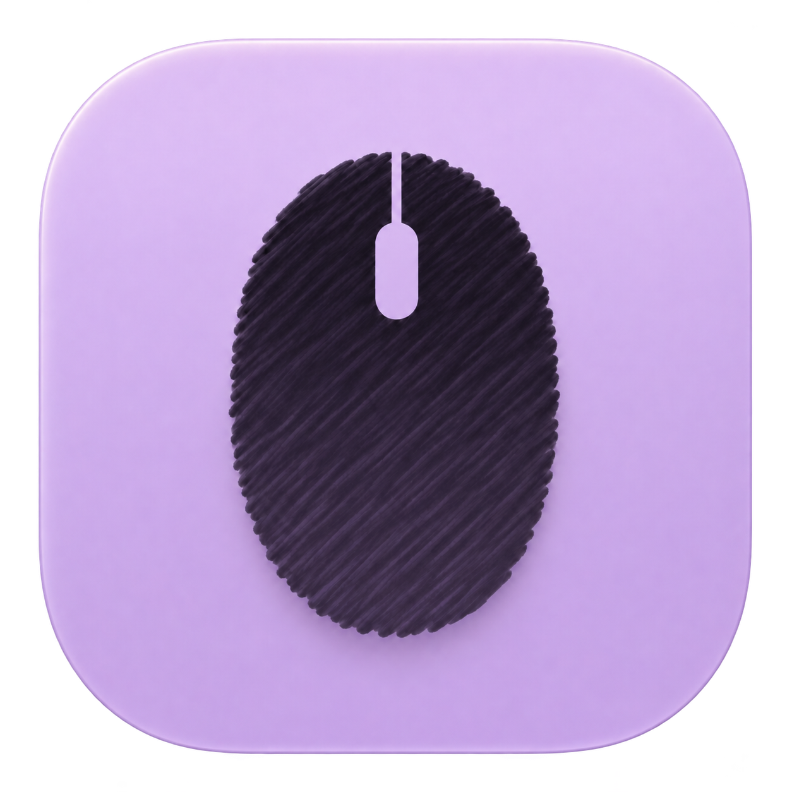
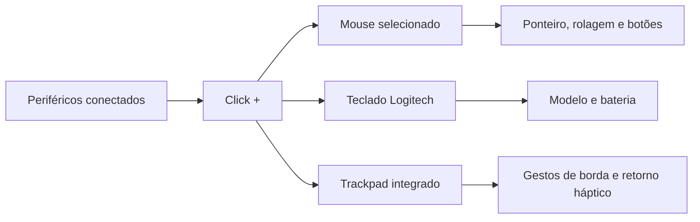

<div align="center">



<h1>Click +</h1>

<p><strong>Seu mouse, seu ritmo. Seus atalhos, ao alcance dos dedos.</strong></p>

<p>Controle nativo de mouse Logitech, bateria do teclado e gestos nas bordas do trackpad para macOS.</p>


<p>
<a href="#funcionalidades">Funcionalidades</a> ·
<a href="#instalação">Instalação</a> ·
<a href="#compatibilidade">Compatibilidade</a> ·
<a href="VALIDATION.md">Validação técnica</a>
</p>

</div>

## Índice

- [Sobre](#sobre)
- [Status e acesso](#status-e-acesso)
- [Funcionalidades](#funcionalidades)
- [Demonstração do fluxo](#demonstração-do-fluxo)
- [Compatibilidade](#compatibilidade)
- [Instalação](#instalação)
- [Primeiro uso](#primeiro-uso)
- [Gestos do trackpad](#gestos-do-trackpad)
- [Tecnologias e arquitetura](#tecnologias-e-arquitetura)
- [Desenvolvimento e testes](#desenvolvimento-e-testes)
- [Solução de problemas](#solução-de-problemas)
- [Roadmap](#roadmap)
- [Contribuição](#contribuição)
- [Autoria e referências](#autoria-e-referências)
- [Licença](#licença)

## Sobre

O Click + é um utilitário de barra de menus para quem usa periféricos Logitech no Mac e quer ajustar a experiência de trabalho: uma rolagem mais confortável, um ponteiro preciso e botões que executam as ações do dia a dia.

A interface em português reúne configurações de mouse, informações de teclado e gestos do trackpad. Cada recurso mantém seus próprios ajustes. O processamento acontece localmente, sem conta, servidor ou envio de telemetria.

A identificação do dispositivo orienta o processamento: ajustes do mouse são aplicados apenas a eventos cuja origem foi reconhecida. Eventos desconhecidos são preservados, e o trackpad tem um serviço separado para seus gestos de borda.

## Status e acesso

**Em desenvolvimento, com execução local pelo Xcode.** O projeto contém o aplicativo e testes automatizados; as evidências e os limites de validação estão em [VALIDATION.md](VALIDATION.md) e [AUDITORIA.md](AUDITORIA.md).

O código está no repositório público [alisoncardosoo/click-plus](https://github.com/alisoncardosoo/click-plus). O app empacotado está disponível nas [Releases](https://github.com/alisoncardosoo/click-plus/releases/latest). Não há site, API ou serviço de produção necessário para utilizá-lo.

A versão `0.2.0` é experimental, compilada em Release para Apple Silicon e Intel, com macOS 14 ou superior. O pacote usa assinatura Apple Development e **não é notarizado**; não equivale a uma distribuição Developer ID aprovada pelo Gatekeeper. Outros Macs podem bloquear sua abertura.

## Funcionalidades

| Área | Recursos |
| --- | --- |
| **Ponteiro e sensor** | Velocidade, aceleração, modificador de precisão e DPI físico quando anunciado pelo dispositivo. |
| **Rolagem** | Suavização, duração, frenagem, aceleração, velocidade por eixo e inversão independente. |
| **Botões** | Cadastro por pressionamento, atalhos, copiar/colar, navegação, Visão de janelas e abertura de aplicativos. |
| **Arrastar para rolar** | Pan com botão configurável, inversão e inércia opcionais. |
| **Trackpad** | Brilho, volume, reprodução, troca de faixas e ações personalizadas nas quatro bordas. |
| **Retorno háptico** | Pulso por etapa ou ação reconhecida, com opção de desligar; requer Force Touch. |
| **Dispositivos** | Seleção do mouse Logitech e leitura de modelo/bateria quando disponível. |
| **Teclado** | Identificação e bateria de teclados Logitech compatíveis. |
| **Bluetooth** | Bateria de fones e outros periféricos conectados, conforme os níveis informados pelo macOS. |
| **Barra de menus** | Painel de baterias dos dispositivos conectados e acesso às configurações. |
| **Avisos de bateria** | Notificações opcionais com limites de bateria baixa e crítica, som e controle de repetição. |
| **Ajustes** | Inicialização com o macOS, ajuda dos controles e contadores locais de entrada. |

<details>
<summary><strong>Como os controles se comportam</strong></summary>

- **Duração:** comprimento do impulso suave em segundos, independente da taxa de atualização da tela.
- **Ponto de frenagem:** posição da curva a partir da qual o impulso desacelera.
- **Suavização extra:** altera a forma do impulso, preservando sua distância total.
- **Aceleração da rolagem:** ganho limitado, proporcional à magnitude da entrada; zero mantém resposta linear.
- **Aceleração do cursor:** curva própria, com isolamento no serviço HID do mouse identificado e restauração da propriedade anterior ao suspender o controle ou sair.
- **Ampliar ou reduzir:** envia atalhos Command +/− ao aplicativo em foco; o resultado depende do suporte do aplicativo.
- **Controles deslizantes:** usa Acessibilidade para ajustar controles compatíveis; sem suporte, a rolagem continua normalmente.
- **Arrastar para rolar:** movimento acima de quatro pontos vira rolagem; um clique curto preserva a ação. Inércia e inversão são opcionais.
- **Clicar em janela inativa:** ativa a janela sob o cursor antes da interação; aplicativos podem impor comportamentos próprios.
- **Frequência:** estimativa dos eventos recebidos, sem garantia de medir o polling físico.
- **Abrir aplicativo:** quando o destino já está em foco, alterna sua interface e retorna ao aplicativo anterior, sem encerrar o processo. O LaunchOS recebe tratamento específico por Escape.

As escalas dos controles são próprias do Click +.

</details>

## Demonstração do fluxo



A interface organiza Mouse, Teclado, Trackpad e Ajustes em áreas próprias. Mouse reúne Ponteiro e sensor, Rolagem e Botões; o painel da barra de menus oferece acesso rápido e leitura de bateria.

## Compatibilidade

**O suporte é determinado pelas capacidades confirmadas de cada dispositivo.** Detectar um modelo não significa que todos os seus controles proprietários estejam disponíveis.

| Dispositivo ou recurso | Situação |
| --- | --- |
| Logitech M650 L | Modelo com validação física registrada. |
| Logitech K950 | Identificação e bateria com validação física registrada. |
| Outros mouses Logitech USB/Bluetooth | Ajustes básicos dependem de uso HID de mouse e identificação dos eventos. Outras famílias foram cobertas por descritores simulados, sem validação física completa. |
| Bolt/Unifying | Descoberta por slot e tipo; movimento só é transformado quando é possível identificar um único mouse no receptor. |
| DPI físico | Exige HID++ `ADJUSTABLE_DPI` (`0x2201`), valores anunciados e confirmação por leitura. |
| Bateria | Exige leitura válida pelo sistema ou HID++ `0x1000`/`0x1004`. |
| Captura avançada de botões | Depende de `REPROG_CONTROLS_V4` (`0x1B04`) e controles reconhecidos; há alternativa por evento nativo identificado. |
| Trackpad | Gestos de borda disponíveis para o trackpad integrado; suporte externo não declarado. |
| Retorno háptico | Requer Force Touch, respeita as preferências do macOS e precisa de confirmação física. |

As configurações do mouse são globais e aplicadas ao dispositivo selecionado; não há perfis independentes por modelo. Teclados oferecem identificação e bateria, sem remapeamento geral de teclas.

O projeto não implementa firmware, pareamento, macros ou perfis por aplicativo. Não instala agentes privilegiados.

Fones e outros acessórios Bluetooth são listados na área **Bluetooth** e no painel de baterias quando conectados. A consulta local usa `system_profiler`, em segundo plano, a cada 30 segundos. Para **Samsung Galaxy Buds2**, o app mantém o canal de status RFCOMM do fone já conectado e pareado aberto para receber a bateria de cada lado e do estojo em tempo real, sem enviar comandos ou alterar configurações. A leitura física confirmou níveis independentes esquerdo e direito. O canal permanece ativo enquanto o fone está conectado e é encerrado ao sair do app ou detectar a desconexão. Ao fechar a tampa, a última leitura válida do estojo é mantida durante a execução do app, com indicação de data e hora. Uma nova leitura substitui esse valor. Sem nenhuma leitura anterior, a linha Estojo orienta a abrir a tampa com pelo menos um fone dentro e atualizar. Dispositivos desconectados são ocultados no painel da barra de menus. Outros modelos dependem dos dados do macOS; acessórios sem leitura mostram “Bateria não informada”. A leitura direta ainda não é declarada compatível com outras gerações Galaxy Buds.

## Instalação

### Instalar o app empacotado

1. Acesse a [release mais recente](https://github.com/alisoncardosoo/click-plus/releases/latest) e baixe `ClickPlus-0.2.0-macOS-universal.zip`.
2. Extraia o ZIP e mova `Click +.app` para a pasta **Aplicativos**.
3. Abra o aplicativo e siga as instruções de [primeiro uso](#primeiro-uso).

O arquivo `SHA256SUMS.txt` da release permite conferir a integridade do ZIP com `shasum -a 256`. A assinatura Apple Development não garante aceitação em outros Macs. Se o macOS bloquear o aplicativo, consulte a mensagem em **Ajustes do Sistema → Privacidade e Segurança**; a autorização de abertura, quando disponível, deve ser feita conscientemente pelo usuário. O pacote não altera as proteções do sistema.

### Compilar a partir do código

#### Requisitos

- Mac com **macOS 14 ou superior**.
- Xcode com SDK compatível e ferramentas de linha de comando selecionadas.
- Identidade local de assinatura Apple Development configurada no Xcode.
- Permissões de Acessibilidade e Monitoramento de Entrada para os recursos de captura.

### Obter o código

O repositório é público e pode ser clonado sem autenticação:

```sh
git clone https://github.com/alisoncardosoo/click-plus.git
cd click-plus
```

Como alternativa, use **Code → Download ZIP** no GitHub e extraia o projeto.

Abra a pasta do projeto no Terminal e execute:

```sh
open ClickPlus.xcodeproj
```

Em **Signing & Capabilities**, selecione seu time de desenvolvimento nos alvos do aplicativo e dos testes. O projeto contém uma configuração de assinatura local que deve ser adaptada em outro Mac.

### Compilar e abrir

```sh
./script/build_and_run.sh
```

O script encerra a instância anterior, compila, registra o bundle e abre a versão recém-gerada. A ação **Run** do Codex usa o mesmo script.

Aplicativo gerado:

```text
build/Build/Products/Debug/Click +.app
```

Não há dependências de runtime externas, variáveis de ambiente, banco de dados ou Docker para configurar. O projeto Xcode está incluído; XcodeGen só é necessário se você alterar `project.yml` e precisar regenerá-lo.

## Primeiro uso

1. Encerre temporariamente outros controladores de mouse, como BetterMouse ou Logi Options+, para evitar disputa pela entrada.
2. Abra o Click + e conceda **Acessibilidade** e **Monitoramento de Entrada** em Ajustes do Sistema. Reabra o aplicativo se solicitado.
3. Em **Mouse**, selecione o dispositivo e habilite os recursos desejados. DPI e bateria dependem de respostas reais do hardware.
4. Em **Mouse → Botões → Adicionar botão**, pressione e solte o botão físico, escolha a ação e salve.
5. Em **Trackpad**, ative os gestos de borda e personalize as funções.
6. Em **Ajustes**, habilite a inicialização com o macOS se desejar.

O serviço permanece ativo enquanto o aplicativo está aberto. Para encerrá-lo, use **Sair** no painel da barra de menus; não há interruptor geral de ativar/pausar.

As preferências são persistidas localmente no domínio `br.com.ratoesperto.app`. Esse identificador histórico é mantido para preservar assinatura, permissões, preferências e inicialização automática. Os ajustes do trackpad são salvos separadamente dos ajustes do mouse.

## Gestos do trackpad

Comece com **um dedo dentro da faixa da borda** e deslize ao longo dela. O centro e os gestos com vários dedos preservam o comportamento normal.

| Borda | Função inicial |
| --- | --- |
| Esquerda | Volume |
| Direita | Brilho da tela |
| Inferior | Trocar faixas |
| Superior | Desativada |

Esses são os padrões de uma instalação nova; escolhas já salvas são preservadas. Todas as bordas permitem desligar a função ou escolher brilho, volume, faixas, reproduzir/pausar e ações personalizadas por direção.

- Cima/direita aumenta ou avança; baixo/esquerda diminui ou volta.
- Volume e brilho ajustam em etapas durante o deslize.
- Faixas e ações personalizadas executam uma vez por contato; levante o dedo para repetir.
- A borda inferior oferece toque curto opcional para reproduzir/pausar.
- Largura da faixa e distância por etapa são ajustáveis.
- O retorno háptico vem ativado e pode ser desligado em **Trackpad → Retorno háptico**.

O pulso confirma o reconhecimento do gesto, sem verificar o resultado no aplicativo de destino. Reprodução depende do player ativo; brilho depende de uma tela que responda às teclas de brilho do macOS.

## Tecnologias e arquitetura

| Tecnologia | Responsabilidade |
| --- | --- |
| Swift e SwiftUI | Modelos, estado e interface nativa. |
| AppKit | Integração com o macOS e retorno háptico. |
| Core Graphics e Acessibilidade | Processamento de eventos e interação com controles compatíveis. |
| IOKit/HID e Logitech HID++ | Identificação, capacidades, bateria, DPI e botões. |
| ServiceManagement | Inicialização com o macOS. |
| XCTest | Testes de comportamento e modelos. |
| XcodeGen | Descrição do projeto em `project.yml`. |

```text
ClickPlus/
├── App/          # Entrada do aplicativo
├── Assets.xcassets/
├── Models/       # Preferências, reconhecimento de gestos e matemática
├── Services/     # Eventos, hardware, acessibilidade e trackpad
├── Stores/       # Estado, persistência e coordenação
├── Support/      # Integração com tipos multitouch
└── Views/        # Configurações e painel da barra de menus
Tests/            # Testes automatizados
script/           # Compilação e execução
ClickPlus.xcodeproj/
project.yml
```

### Identificação e limites de API

Core Graphics não expõe publicamente toda a origem física dos eventos. `DeviceIdentity` consulta opcionalmente `CGEventCopyIOHIDEvent` e `IOHIDEventGetSenderID`; `PointerController` isola o acesso ao serviço HID. Se a origem ou os símbolos necessários não puderem ser confirmados, os eventos permanecem intactos. Não há atribuição de dispositivo por proximidade temporal.

Os gestos de borda usam `MultitouchSupport`, uma API não pública, com verificações de símbolos e layout dos contatos. Atualizações do macOS podem exigir adaptações. A supressão de movimento/rolagem durante gestos reconhecidos se limita a eventos identificados como trackpad.

Consultas HID++ são filtradas pelo dispositivo de origem. O DPI original é preservado antes de uma escrita e sua restauração é solicitada ao desativar o controle ou sair. Falhas de leitura são apresentadas como indisponibilidade, sem simular valores.

## Desenvolvimento e testes

Execute os testes a partir da raiz:

```sh
xcodebuild -project ClickPlus.xcodeproj -scheme ClickPlus -derivedDataPath build test
```

Compile e confirme que o processo abriu:

```sh
./script/build_and_run.sh --verify
```

| Comando do script | Finalidade |
| --- | --- |
| `./script/build_and_run.sh` | Compilar e abrir. |
| `./script/build_and_run.sh --build` | Apenas compilar. |
| `./script/build_and_run.sh --verify` | Compilar, abrir e verificar o processo. |
| `./script/build_and_run.sh --debug` | Compilar e iniciar pelo LLDB. |
| `./script/build_and_run.sh --logs` | Compilar, abrir e acompanhar logs locais. |
| `./script/build_and_run.sh --telemetry` | Compilar, abrir e acompanhar o fluxo de logs locais do processo. |

Não execute build e testes simultaneamente na mesma pasta DerivedData. O log de compilação do script fica em `/tmp/clickplus-build.log`.

Para gerar o pacote universal de uma release:

```sh
./script/package_release.sh
```

O script compila em configuração Release, verifica a assinatura e as duas arquiteturas e gera um ZIP com checksum em `dist/`. Ele não publica no GitHub nem realiza notarização. A versão vem das configurações `MARKETING_VERSION` e `CURRENT_PROJECT_VERSION` de `project.yml`; regenere o projeto com XcodeGen após alterá-las.

Os testes cobrem modelos, matemática de rolagem, decisões sobre entrada, identificação de dispositivos e reconhecimento de bordas. Testes simulados não substituem validação física de transporte, bateria, botões, player ou sensação háptica. Consulte [VALIDATION.md](VALIDATION.md) para as evidências por etapa.

## Solução de problemas

<details>
<summary><strong>Botões laterais pararam após usar outro controlador</strong></summary>

Encerre BetterMouse/Logi Options+ e use **Mouse → Botões → Restaurar cliques nativos do mouse**. O comando remove o desvio temporário para notificações HID++ e confirma por leitura, preservando as atribuições locais e o DPI. Depois repita **Adicionar botão**.

A identificação avançada reserva temporariamente os controles anunciados pelo dispositivo e restaura o modo anterior ao concluir. Um botão já cadastrado é editado na mesma entrada, sem disparar a ação antiga durante a identificação. Clique esquerdo/direito e eventos do trackpad não são cadastrados nesse fluxo.

</details>

<details>
<summary><strong>Mouse aparece, mas DPI ou bateria não estão disponíveis</strong></summary>

A identificação HID pode funcionar mesmo sem os recursos HID++ necessários. Confira o dispositivo selecionado, a conexão e o estado exibido na interface. Receptores com múltiplos mouses podem impedir a identificação inequívoca dos eventos.

</details>

<details>
<summary><strong>Gestos ou retorno háptico não respondem</strong></summary>

Confira as permissões, a ativação dos gestos e a função da borda. Inicie com um dedo na faixa configurada; gestos iniciados no centro não se tornam gestos de borda durante o mesmo contato. O retorno háptico exige Force Touch e depende dos ajustes do macOS. A implementação atual reconhece somente o trackpad integrado.

</details>

<details>
<summary><strong>Como verificar a origem dos eventos</strong></summary>

Em **Ajustes → Verificação de entrada**, acompanhe contadores locais de eventos de mouse, eventos de trackpad preservados e transformações. Esses contadores não armazenam teclas ou conteúdo. Ausência de entrada física durante um teste não confirma o funcionamento do recurso.

</details>

## Roadmap

Estado da implementação e próximos pontos de validação; itens pendentes não representam promessa de entrega.

- [x] Interface nativa em português com ajuda dos controles.
- [x] Ajustes de ponteiro, rolagem e botões.
- [x] Seleção de mouse Logitech e consulta de capacidades.
- [x] Leitura de bateria de mouse e teclado compatíveis.
- [x] Gestos configuráveis nas bordas do trackpad integrado.
- [x] Opção de retorno háptico.
- [ ] Ampliar validação física para outros modelos e conexões Logitech.
- [ ] Confirmar retorno háptico em hardware compatível.
- [ ] Documentar testes adicionais com receptores e players.

## Contribuição

Antes de propor uma alteração, consulte [AUDITORIA.md](AUDITORIA.md) para conhecer comportamentos, evidências e pendências.

1. Descreva o problema com versão do macOS, modelo e conexão do periférico, comportamento esperado e resultado observado.
2. Prepare uma branch com uma mudança de escopo claro; preserve preferências existentes e o isolamento entre dispositivos.
3. Mantenha a divisão entre modelos, serviços, estado e interface. Use português nos textos voltados ao usuário.
4. Execute testes pertinentes e build; registre separadamente os testes automatizados e a validação física.
5. Abra uma issue ou envie um pull request a partir de um fork, incluindo evidências e limitações.

A licença de uso e distribuição ainda precisa ser definida antes de tratar o código como open source.

## Autoria e referências

Desenvolvido por [**alisoncardosoo**](https://github.com/alisoncardosoo).

A implementação consulta interfaces e formatos documentados em:

- [Apple Core Graphics](https://developer.apple.com/documentation/coregraphics/cgevent).
- [Apple AppKit — NSHapticFeedbackManager](https://developer.apple.com/documentation/appkit/nshapticfeedbackmanager).
- [LinearMouse — identificação de eventos](https://github.com/linearmouse/linearmouse/blob/main/LinearMouse/Device/DeviceManager.swift).
- [LinearMouse — propriedades de serviço HID](https://github.com/linearmouse/linearmouse/blob/main/Modules/PointerKit/Sources/PointerKit/PointerDevice.swift).
- [Solaar — catálogo de recursos HID++](https://github.com/pwr-Solaar/Solaar/blob/master/docs/features.md).

Logitech e os nomes de seus produtos pertencem aos respectivos titulares. O Click + é um projeto independente.

## Avisos de bateria

Em **Ajustes → Avisos de bateria**, ative as notificações e permita os avisos no macOS. Os limites iniciais são 20% e 5%; ambos e o som podem ser ajustados. O recurso acompanha o mouse selecionado, teclados e componentes Bluetooth cujos níveis estejam disponíveis. O aplicativo precisa continuar em execução, inclusive na barra de menus.

Cada limite avisa uma vez por periférico/componente até uma leitura confirmar recarga acima do limite de bateria baixa com margem de 3 pontos (limitada a 99%). O histórico permanece salvo ao reiniciar. Acessórios que não informam bateria não geram avisos.

## Licença

Este checkout não contém um arquivo `LICENSE`. Não há licença de uso, modificação ou redistribuição declarada no projeto.

---

<div align="center">

<strong>Click +</strong><br />
Controle local. Interface nativa. Ajustes no seu ritmo.

[Começar](#instalação) · [Auditoria](AUDITORIA.md) · [Validação](VALIDATION.md)

</div>
